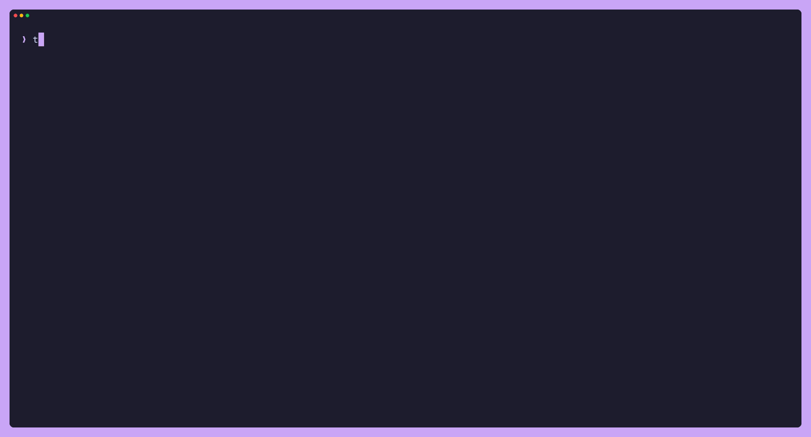

# The TUI

`tdo` (or `tdo tui`) opens the terminal UI on the vdir from your config, or the one given with
`--vdir`. `?` shows every key.



## The screen

```
╭ Views ───────╮╭ Today · Monday 2 Nov ─────────────────╮╭ Details ──────────────╮
│ ◷ Today  2│3 ││ OVERDUE                             1 ││ Renew library books   │
│   All   2│10 ││ ▌○ Renew library books    Yesterday  ││                       │
│   Scheduled 1││                                      ││ List    Inbox         │
│   Done      2││ TODAY                               1 ││ Due     Yesterday     │
│ ─ Lists ──── ││ ▌↺ Water plants    weekly   Today    ││                       │
│ ▌ Bills     6││                                      ││                       │
│ ▌ Inbox   1│2││                                      ││                       │
│ ▌ Personal1│2││                                      ││                       │
│ ─ Smart lists││                                      ││                       │
│   Next 3 Days││                                      ││                       │
╰──────────────╯╰──────────────────────────────────────╯╰───────────────────────╯
 NORMAL Tasks · j/k move  x done  t today  ] +1d  o new  / search  : cmd  ? help   Today·1/2
```

- **Views** (left): the views, your lists with their colour bars, and smart lists. `2│3` is
  "due today or overdue │ all"; see [tasks.md](tasks.md#views-and-date-groups) for what each view
  shows. List groups come from `[[groups]]` in [config.md](config.md).
- **Tasks** (middle): the current view under date-group headers. `○` a task, `↺` a repeating
  task with its rule, `[3]` a checklist or project with 3 items. The bar on the left is the
  list's colour. Overdue rows are red.
- **Details** (right): the selected task's list, dates, repeat, alerts, warnings, its items (on a
  parent) and notes. It appears when the terminal is at least 110 columns wide.
- **Status line**: the mode (`NORMAL`, `INSERT`, `COMMAND`), the focused pane, key hints or the
  last message, and the position in the view. An indicator appears when files could not be read
  (`:errors`).

The focused pane has a bold blue border. The sidebar takes a fifth of the width (24 to 40
columns), or a third below 60 columns.

Colours come from your terminal's 16-colour palette, so the TUI follows your terminal theme and
re-colours live when it changes. Only the list bars use the lists' own (true) colours.

The TUI reloads when files in the vdir change, for example after a sync, and every minute, so
"today" and the groups stay current.

## Keys

### Moving around

| Key | What it does |
|---|---|
| `j` / `k`, `gg` / `G`, `Ctrl-d` / `Ctrl-u` | move down / up, to the top / bottom, half a page. With Details focused they scroll it instead |
| `h` / `l`, `Tab` | focus the previous / next pane |
| `1`–`5` | Today, All, Scheduled, Done, Next 3 Days |
| `Enter` in the sidebar | open the view or list |
| `Enter` on a parent | expand or collapse its items (All and lists) |
| `/`, then `n` / `N` | search the current view by title; `Enter` keeps the filter, `Esc` clears it |
| `?` | help; `Esc` closes it |

### Changing tasks

These act when the Tasks or Details pane has focus.

| Key | What it does |
|---|---|
| `x` / `Space` | complete the selected task; on a completed task, reopen it. On a checklist or project with open items it asks first: press `x` or `Space` again to confirm, any other key cancels |
| `t` / `T` | due today / tomorrow (a timed due keeps its time) |
| `]` / `[` | due one day later / earlier (no due date: counts from today) |
| `}` / `{` | due one week later / earlier |
| `dd` | delete |
| `u` / `Ctrl-r` | undo / redo the last write of this session |
| `m` | move to another list (picker: `j`/`k`, `Enter`, `Esc`) |
| `o` / `O` | new task below / above the selected one ([Adding tasks](#adding-tasks)) |
| `a` | new item at the end of the selected project or checklist; on a plain task, asks whether to make it one first |
| `ct` / `cp` / `cc` | change the selected task's type to task / project / checklist; any other second key cancels. A project with items can't be converted, as on the iPhone: the write is refused with the reason. The type it already has writes nothing (a plain task with items shows as a project, but `ct` on it says it is already a task) |
| `i`, or `Enter` on a task without items | edit card |
| `r` | edit card, on the Repeat field |

On a checklist or project, a write acts on the whole family; see
[tasks.md](tasks.md#completing-reopening-moving-deleting).

### Commands

| Command | What it does |
|---|---|
| `:list <name>` | open a list by name (or collection id), also a hidden one |
| `:sync` | sync now (needs `[sync]` in the config; [sync.md](sync.md)) |
| `:sync! <list>` | sync and accept that a list was emptied on purpose ([sync.md](sync.md)) |
| `:conflicts` | show sync conflicts; `l` keeps the local version, `r` the remote one |
| `:errors` | list files that could not be read |
| `:q` | quit |

## Adding tasks

`o` opens an empty row below the selected task, `O` above it. Type the title straight into the
list; the status line shows where the task will go:
`New task in Inbox · Enter save  Tab more  Esc cancel`.

| Where the cursor is | The new task |
|---|---|
| a list | goes into that list |
| Today | goes to the default list, due today |
| All, Scheduled, Done, Next 3 Days | goes to the default list, with no dates |
| an item of a project or checklist (any view) | becomes another item of the same parent; in Today a project item is due today, a checklist item has no dates |

The default list is `default_list` from the config ([config.md](config.md)), else the list named
Inbox, else the first list.

On the row:

- `Enter` saves. The cursor goes to the new task; when the view does not show it (a task
  without dates added in Scheduled, say), the status line says `Added "…" to Inbox` and the
  cursor stays. `Enter` on an empty row closes it.
- Inside a project or checklist, `Enter` saves and opens the next item's row below it, so you
  can type a whole checklist in one go. Each saved item is its own write and undo step.
- `Tab` opens the [edit card](#the-edit-card) for the new task, keeping the title.
- `Esc` closes the row and writes nothing. Items already saved by `Enter` stay.
- `Backspace`, `Ctrl-u` (clear) and `Ctrl-w` (delete a word) edit the title; a paste goes in as
  one line.

`a` on a project or checklist opens an item row at the end of its items, expanding it. On an
item it adds another item at the end of the same parent. On a plain task it asks first:
`Add items: make it a (p)roject or (c)hecklist?`. `p` or `c` converts the task (one write) and
then opens the item row; any other key cancels. If the conversion is refused, the status line
says why and no row opens.

If a save is refused, the row stays with your text and the status line shows why. When the
parent was deleted meanwhile (on the phone, say), the row closes instead: there is nothing left
to add items to.

## The edit card

The task's row opens in place into a card; the rows below move down, and the list and the
Details pane stay in view. The view scrolls so the whole card shows.

```
│ LATER TODAY                                     1 │
│ ╭───────────────────────────────────────────────╮ │
│ │ Call the dentist▏                             │ │
│ │ ▌Inbox ▸   Task                               │ │
│ │ Due     2026-11-04 15:00  → Wed 4 Nov 15:00   │ │
│ │ Start   —                                     │ │
│ │ Repeat  none                                  │ │
│ │ Notes   —                                     │ │
│ ╰ Ctrl-s save · Tab next · Esc cancel ──────────╯ │
│ TODAY                                           1 │
```

Fields, in `Tab` order:

| Field | Input |
|---|---|
| Title | text; must not be empty |
| List | the list, in its colour. `Enter` opens the list picker (as `m`); the choice is saved with the rest, as a move |
| Type | Task, Project or Checklist: `Space` or `l` next, `h` previous. Saving converts the task ([tasks.md](tasks.md)) |
| Due, Start | a date (below) |
| Repeat | a typed rule (below); `none` when the task does not repeat |
| Notes | `Enter` opens `$VISUAL` or `$EDITOR` (else `vi`); save and quit to bring the text back |

An item of a project has no List (it lives in its parent's list). An item of a checklist shows
only Title and Notes: checklist items have no dates or repeat of their own, and `r` on one says
so.

- `Tab` / `Shift-Tab` (or `↓` / `↑`) move between fields; `Enter` saves (on List and Notes it
  opens the picker or the editor), `Ctrl-s` saves from any field.
- `Esc` cancels: nothing is written, whatever you changed (the list too).
- `Ctrl-u` clears a field, `Ctrl-w` deletes a word. Pasted text goes into the focused field as
  one line.
- Only the fields you changed are written, as one save: the changes and the move are written
  together or not at all, and `u` undoes them in one step. If any part is refused, nothing is
  written, and the card stays open with what you typed and the reason.

When the Tasks pane is narrower than 40 columns or too short for the card, the same card opens
centred over the screen instead, titled `Edit task`.

Due and Start take:

| Input | Means |
|---|---|
| empty | no date |
| `today` `tod` `tomorrow` `tom` | that day |
| `3d` `2w` `1m` `1y` | from today (`m` is months; month ends clamp: Jan 31 + 1m = Feb 28) |
| `15th` | the next 15th after today |
| `fri`, `friday` | the next Friday, never today |
| `2026-11-20` | that date |
| a time after any of these, or alone (today) | `5pm`, `930a`, `9:30 pm`, `14:30`, `noon`, `midnight` |

A bare number such as `9` is rejected as ambiguous. Start dates take no time. The text beside
each date shows how it was read (`→ Fri 6 Nov 10:00`).

Repeat takes a rule, then any modifiers:

| Input | Repeats |
|---|---|
| empty, `none` | never (on a repeating task: removes the repeat) |
| `daily`, `3d`, `every 3 days` | every N days |
| `weekly`, `biweekly`, `2w`, `every 2 weeks` | every N weeks |
| `monthly`, `3m`, `every 3 months` | every N months, on the due date's day |
| `yearly`, `2y`, `every 2 years` | every N years, on the due date |
| `mon thu`, `mon,thu`, `every mon and thu`, `workdays` | on those weekdays (`workdays` is the config's `work_days`, default Monday to Friday) |
| `last day`, `last day every 2m` | on the last day of the month |
| `2nd tue`, `last fri` | on that weekday of each month |
| `1st weekday`, `last weekend day` | on that workday (Monday to Friday) or weekend day of each month |
| modifiers: `after done`, `until 2027-06-01`, `10 times` | from the completion date; until a date; that many times |

The field takes no day of the month: monthly and yearly repeats follow the due date, so set the
day in Due. While the field is empty, the text beside it lists examples; otherwise it shows the
rule in 2Do's words (`→ The second Tue of each month · from due date`). On a task that repeats,
an emptied field (or `none`) reads `→ none (removes the repeat)`: saving removes the rule. A task that repeats
starts with its rule in this syntax, so changing it is editing text. A repeat needs a due date:
set one on a task without a due date and it becomes due today (the preview ends in
`· due today`).

A few rules 2Do can store cannot be typed here (monthly on a fixed day of the month other than
the due date's, for example). On such a task the field starts empty, the text beside it names
the rule and ends in `(kept)`, and saving leaves the rule alone unless you type a new one, or
`none` to remove it.

## When a write is refused

The status line says why, and nothing is written:

- **`… is not verified yet`**: Twydo has not verified this write against 2Do on the iPhone, for
  example `weekdays-set repeats are not verified yet`, or `changing the repeat rule of one-time
  tasks is not verified yet (twydo_to_iphone)` for setting a repeat. See
  [compatibility.md](compatibility.md#verified-mode).
- **`… changed on disk; reload and try again`**: a sync changed the task after you started. The
  view reloads; an open card switches to the synced version, so you see the new data before
  saving again.
- **A sync is running.** A sync holds the vdir while vdirsyncer runs. The save waits up to two
  seconds, so an ordinary sync finishes unnoticed. If it is still running after that, the status
  line asks `sync running for 2m 14s — stop it and save? (y/n)`:
  - `y` stops the sync and saves (the message ends in `· sync stopped`). The stopped sync counts
    as a failed one ([sync.md](sync.md#stopping-a-sync)): it backs off, and your edit stays
    pending until the next sync that works sends it. Any sync can be stopped this way, whether the
    TUI, the timer or a `tdo sync` started it. If it does not let go within ten seconds, nothing is
    written: `not saved; the sync did not stop`.
  - `n` or `Esc` writes nothing: `not saved; the sync is still running`. An open edit card or
    new row stays open with what you typed; for a one-key action, press the key again later.

  Other keys do nothing while the question is open. When the TUI cannot tell which sync holds the
  vdir, it says `a sync is running; try again in a moment` instead.
- **`cannot write: …`**: the operation journal could not be opened
  ([architecture.md](architecture.md#the-operation-journal)). Your tasks are still shown.

Success messages clear after five seconds. With `[sync] after_edit = true` (the default when
sync is on), a background sync starts once writes pause for three seconds, so quick writes in a
row (closing checklist items one by one) do not wait on a sync started by the one before.
Quitting starts a pending sync at once.

## Not in the TUI yet

Natural-language input on the new row (dates typed with the title), `J` / `K` (manual order;
until then `o` and `O` differ only while typing), alerts and list management. `J` and `K` show
`not available yet`; the help marks them `(after gate)`.
